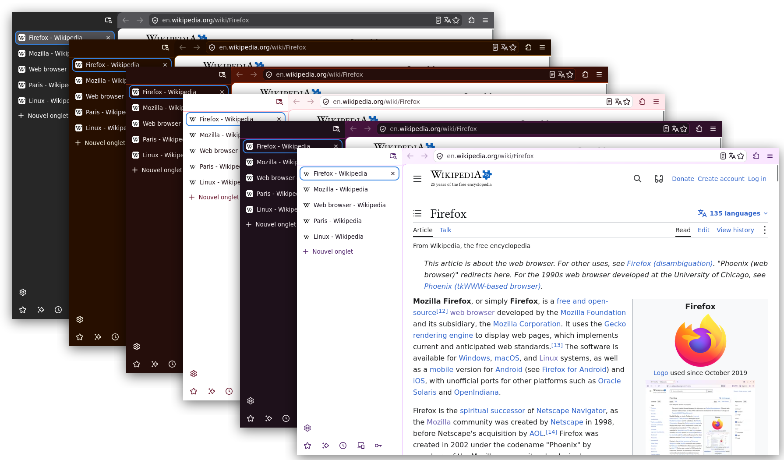

# Firefox → Chrome-like layout (native vertical tabs)

`userChrome.css` for Firefox 159 (tested on Ubuntu) with native vertical
tabs:

- the tabs panel reaches the top of the window;
- the navigation bar only takes the area to the right of the panel;
- tabs as rounded, spaced rows, pill-shaped "+" button;
- back / forward buttons keep Firefox's native icons, to stay consistent
  with the context menu shown by a right click on a page;
- empty area at the top of the panel (level with the navigation bar)
  that acts as a grip to move the window, with the native "collapse /
  expand sidebar" and "list / search tabs" buttons moved into this
  area, and a thin separator below it;
- panel background slightly distinct from the navigation bar (Firefox's
  native sidebar color, no imposed tint);
- in a narrow window, the address bar shrinks further so it never goes
  under the bar's native buttons or the window controls; Firefox moves
  the other buttons (VPN, account…) into the "»" overflow menu before
  the bar becomes too small, and the suggestions list keeps a readable
  width, centered under the bar;
- no imposed colors: the current Firefox theme is kept;
- address bar and buttons as rectangles with slightly rounded corners
  (instead of the native pills), whatever the tabs mode;
- in horizontal tabs mode, only this shape changes: the layout stays
  native.

The layout follows the active Firefox theme instead of imposing colors.
With the official Mozilla themes (Default, Sun, Spark, Flame, Flare,
Lavender, light and dark variants where available):



## Installation

1. Run:

   ```bash
   bash install.sh
   ```

   Without an argument, the script lists the profiles of the detected
   Firefox (deb, snap and flatpak are all inspected) and offers to pick
   one: type its number, or Enter for the default profile. A path can
   also be pasted at the prompt, or passed as an argument:

   ```bash
   bash install.sh "/path/to/profile"
   ```

   The profile directory is shown in `about:support`, row "Profile
   Directory".

2. Fully restart Firefox.

The script enables `toolkit.legacyUserProfileCustomizations.stylesheets`
in `user.js` (with a timestamped backup) and backs up any existing
`chrome/userChrome.css` before replacing it.

## Uninstall

Delete `chrome/userChrome.css` from the profile (or restore the `.bak.*`
backup) and restart Firefox.

## Settings

The variables at the top of `userChrome.css` (`--fxc-*`) control tab
radius, height and spacing, and the height of the empty area at the top
of the panel (`--fxc-grip-h`, to align with the navigation bar height if
the toolbar density changes).

## Known limitations

- The window grip uses the native `-moz-window-dragging` mechanism; it
  behaves like the empty area of a Firefox toolbar.
- The "collapse sidebar" and "list / search tabs" buttons only appear in
  the empty area if they are present in the navigation bar (native
  buttons moved, not duplicates). In a very narrow window, the "list /
  search tabs" button may be moved by Firefox into the navigation bar's
  "»" overflow menu; it remains accessible there.
- Back, forward, reload, extensions and the main menu never go into the
  "»" menu (Firefox choice): in a very narrow window, the address bar
  can only keep the room they leave.
- Opening the collapsed panel on hover (expand-on-hover) is not
  retested on every change; report it if an issue shows up.

## Development rules

- Rely on Firefox conventions (native attributes, variables and
  mechanisms), so that new versions are easy to follow.
- After changing `install.sh`, run `bash test-install.sh` (tests on a
  fake `$HOME`, nothing else is touched).
- The committed version is our version, not a version to preserve.
- Firefox's behavior without a custom `userChrome.css` remains a useful
  baseline.
